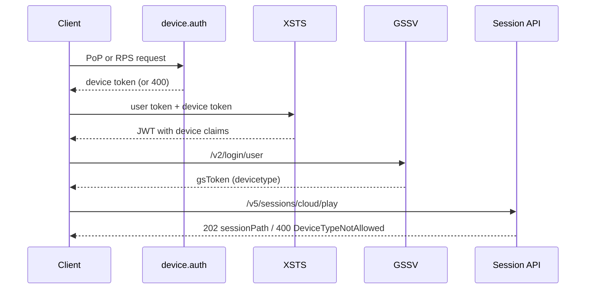

# Authentication flow

End-to-end view of the chain that ends in a cloud session. Field **names** are published;
field **values** are not.

## 1. Device authentication

Endpoint: `POST https://device.auth.xboxlive.com/device/authenticate`

Three request shapes were observed.

**Client proof-of-possession (our synthetic client)**

```json
{
  "RelyingParty": "<24 chars>",
  "TokenType": "JWT",
  "Properties": {
    "AuthMethod": "ProofOfPossession",
    "DeviceType": "Win32",
    "Id": "{GUID}",
    "ProofKey": { "kty": "EC", "alg": "ES256", "crv": "P-256", "use": "sig", "x": "...", "y": "..." },
    "Version": "10.0.22000"
  }
}
```

Signed with the Xbox Live PoP scheme: a header of policy version, FILETIME and an ECDSA
P-1363 signature over the request, plus a `Signature` header and
`x-xbl-contract-version: 2`.

**Console (security-processor attestation)**

```json
{
  "RelyingParty": "http://auth.xboxlive.com",
  "TokenType": "SP_JWT",
  "Properties": {
    "Attestation": "<744 bytes, base64, minted for a fresh nonce>",
    "BootLog": "<320 bytes, base64, session public key>",
    "Certificate": "<1024 bytes, base64, console certificate, magic CC>",
    "DeviceType": "Scarlett",
    "EffectiveRegion": "None"
  }
}
```

No `Signature` header, no `x-xbl-contract-version`, and none of the desktop fields. The request is
2,963 bytes and returns `200` with an **XCOS** token. The nonce comes from `GET /device/nonce` and
is baked into the attestation by the security processor; it never travels in the body. Adding any
desktop field turns that same request into `400`.

**Windows system service (RPS)**

```text
RelyingParty            string
TokenType               string
Properties.AuthMethod   string  (RPS)
Properties.RpsTicket    string  (credential material — never retained)
Properties.SiteName     string
Properties.Version      string
Properties.DeviceModel  string  (hardware model)
Properties.ProofKey     object
# no DeviceType field
```

Outcome:

| Request | Status | Token |
|---|---|---|
| desktop shape, `Win32`/`iOS`/`Android`/`Nintendo` | `200` | device token |
| desktop shape, console type | `400` | none, empty body |
| console shape, SP attestation matching the type | `200` | XCOS (intermediate, not accepted by XSTS) |
| console shape, synthetic material | `400` | none |
| console shape + desktop fields | `400`, or `403` with the shared script's set | none |

## 1a. Device token conversion (no HTTP call)

`device.auth` returns an **XCOS** token. XSTS does not accept it — every combination returns
`400`. The console converts XCOS to a **JWE** locally through `XblaProcessXcosDeviceToken`, which
is not available to apps (`0x87DD0001`). Only the JWE is sent in `Properties.DeviceToken`.

## 2. XSTS authorisation

Endpoint: `POST https://xsts.auth.xboxlive.com/xsts/authorize`

```json
{
  "Properties": {
    "UserTokens": ["<user token>"],
    "DeviceToken": "<device token, optional>",
    "SandboxId": "RETAIL"
  },
  "RelyingParty": "http://gssv.xboxlive.com/",
  "TokenType": "JWT"
}
```

Passing a device token as a member of `UserTokens` fails; it must be
`Properties.DeviceToken` (observed `400` vs `200`).

**Console signature header** (community measured, 2026-11-22): console `xsts/authorize` POSTs
carry a Base64 signature header that decodes to 76 bytes — 4-byte big-endian policy version, 8-byte big-endian FILETIME, and a
64-byte raw ECDSA P-256 signature (`r||s`). An earlier replay returned `200` and a later replay
returned `403`. The inspected Windows build hashes a multi-field envelope that includes the
body. See [XblAuthManager static interface](xblauthmanager-static-interface.md#windows-request-signing).

## 3. GSSV login

Endpoint: `POST https://<offering>.gssv-play-prod.xboxlive.com/v2/login/user`

```json
{ "token": "<XSTS token>", "offeringId": "xgpuweb" }
```

Headers include `x-gssv-client` and a client user agent. The response contains a `gsToken`
(an ordinary JWT) and `offeringSettings` with regions and base URIs.

**Device class propagation** (locally tested):

| XSTS input | `gsToken.devicetype` |
|---|---|
| user token only | absent |
| user + `Win32` device token | `Win32` |
| user + `Android` device token | `Android` |
| user + `iOS` device token | `iOS` |

## 4. Session start

Endpoint: `POST /v5/sessions/cloud/play` on the region base URI.

| Case | Result |
|---|---|
| KI 2013, ordinary PC identity | `202` with `sessionPath` and `queueConfig` |
| KI 2 Classic, ordinary PC identity | `400` `{"code":"DeviceTypeNotAllowed"}` (2026-11-19, reproduced 2026-11-21; the `500` on 2026-11-20 was a missing `X-MS-Device-Info` header) |

The refusal arrives in roughly 400 ms, before queue or instance allocation, and contains no
`sessionPath`.

## 5. Where the decision is made

**Observed:** the device class is present in the session token, the refused title carries an
allowlist, and the accepted title does not.

**Inferred:** GSSV compares the authenticated device class (and possibly other attributes)
against `allowedDeviceTypes` during authorisation. The comparison itself was not observed.

**New (2026-11-20):** the web offering no longer lists the restricted titles at all, which
means filtering also happens when the catalogue is built. See
[device-restrictions.md](device-restrictions.md#catalogue-versus-session).

## Diagram


